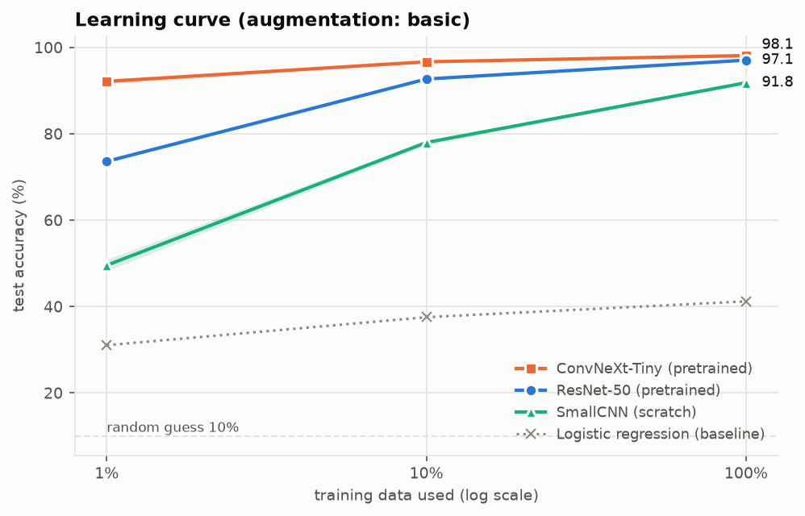
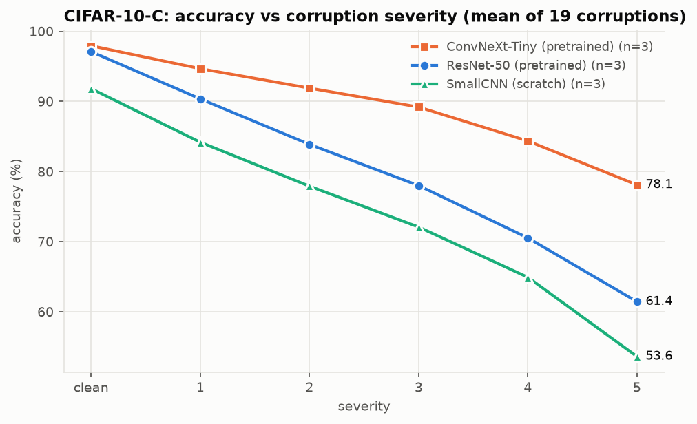

# CNN vs Vision Transformer for Image Classification

Machine Learning and Applications, Topic 7. Compares the inductive biases of CNNs (ResNet,
ConvNeXt) and Vision Transformers with respect to dataset size, data augmentation and compute cost.

**Team:** [names, student IDs, team leader]

**This repository covers the CNN part.** ViT part: [teammate's name and repository link]

Status: the CNN part is complete (63 training runs, 3 seeds each, plus Grad-CAM and CIFAR-10-C).

## What is compared

| Model | Weights | Input | Parameters | Training |
|---|---|---|---|---|
| ResNet-50 (`resnet50.a1_in1k`) | ImageNet-1k | 224 × 224 | 23.5M | fine-tune 8 epochs |
| ConvNeXt-Tiny (`convnext_tiny.fb_in1k`) | ImageNet-1k | 224 × 224 | 27.8M | fine-tune 8 epochs |
| SmallCNN (own design) | random | 32 × 32 | 1.15M | from scratch, 60 epochs |
| Logistic regression on pixels | - | 32 × 32 | 0.03M | baseline |

- **Dataset:** CIFAR-10. Fixed stratified split of 45,000 train / 5,000 validation; the 10,000 test
  images are used once per run, with the checkpoint of the best validation epoch.
- **Learning curves:** 1%, 10% and 100% of the training set (nested, stratified subsets).
- **Augmentation study** at 10% data: none, basic (random crop + flip), strong (basic + RandAugment).
- **Ablation:** frozen backbone (linear probe) and ResNet-50 without pretraining.
- **Interpretation:** Grad-CAM on 20 fixed test images (`results/gradcam_images.json`).
- **Robustness (extension):** CIFAR-10-C, 19 corruptions × 5 severities on a fixed 2,000-image subset.
- **Seeds:** 0, 1, 2 for every setting; results are mean ± std.

Shared settings: AdamW (weight decay 0.05), learning rate 1e-3 for the head and 1e-4 for the
pretrained backbone, 1 warmup epoch then cosine decay, batch size 32, mixed precision.

## Installation

Requires Conda and Python 3.11. The commands below install the CUDA 12.8 build of PyTorch.

```bash
conda create -n cnn-vit python=3.11 -y
conda activate cnn-vit
pip install -r requirements.txt
python scripts/check_env.py
```

CIFAR-10 is downloaded automatically into `data/`. For the robustness extension, download
CIFAR-10-C from [Zenodo](https://zenodo.org/records/2535967) and extract it to `data/CIFAR-10-C/`.

## Project structure

```text
configs/   One YAML config per experiment, inheriting from base.yaml
src/       Data pipeline, models, training loop, Grad-CAM
scripts/   Command-line entry points
tests/     Data pipeline tests
results/   Final tables and figures (committed)
data/      Datasets (downloaded, not committed)
outputs/   Per-run logs, metrics and checkpoints (not committed)
```

## Reproducing the results

```bash
# tests
pytest tests

# one training run (any value in the config can be overridden with --set)
python scripts/train.py --config configs/resnet50_finetune.yaml --set seed=0 data.train_fraction=0.1

# baseline
python scripts/baseline_logreg.py

# the full grid: learning curves, augmentation study and ablation (63 runs, skips finished runs)
python scripts/run_experiments.py
python scripts/run_experiments.py --dry-run          # list the runs without training

# robustness, Grad-CAM, tables and figures
python scripts/eval_cifar10c.py --runs frac1.0_augbasic_seed0 frac1.0_augbasic_seed1 frac1.0_augbasic_seed2
python scripts/visualize.py
python scripts/summarize_results.py
```

On Windows, `scripts/run_all.ps1` runs all of the last five commands in order.
Each run writes `outputs/<experiment>/frac<f>_aug<a>_seed<s>/` with `config.yaml`, `history.csv`,
`metrics.json` and the test predictions.

## Results

All numbers are test accuracy (%), mean ± std over 3 seeds.
Hardware: NVIDIA GeForce RTX 3050 Ti Laptop GPU (4 GB), PyTorch 2.11, timm 1.0.31.
Full tables: [`results/summary.md`](results/summary.md) and
[`results/cifar10c_summary.md`](results/cifar10c_summary.md).

### Learning curves (basic augmentation)

| Model | 1% (450 images) | 10% (4,500) | 100% (45,000) |
|---|---|---|---|
| ConvNeXt-Tiny (pretrained) | **92.14 ± 0.61** | **96.69 ± 0.19** | **98.13 ± 0.09** |
| ResNet-50 (pretrained) | 73.62 ± 0.35 | 92.70 ± 0.25 | 97.06 ± 0.14 |
| SmallCNN (scratch) | 49.57 ± 1.35 | 77.99 ± 0.52 | 91.84 ± 0.13 |
| Logistic regression | 31.05 ± 0.47 | 37.54 ± 0.33 | 41.21 ± 0.00 |



### Augmentation (10% data)

| Model | None | Basic | Strong |
|---|---|---|---|
| ConvNeXt-Tiny | 96.35 ± 0.12 | 96.69 ± 0.19 | 96.68 ± 0.22 |
| ResNet-50 | 92.12 ± 0.35 | 92.70 ± 0.25 | 92.81 ± 0.21 |
| SmallCNN | 71.77 ± 0.75 | 77.99 ± 0.52 | **79.73 ± 0.47** |

### Ablation

| Variant | Trainable params | 10% data | 100% data |
|---|---|---|---|
| ResNet-50, full fine-tune | 23.5M | 92.70 ± 0.25 | 97.06 ± 0.14 |
| ResNet-50, frozen backbone | 0.02M | 88.04 ± 0.17 | 91.74 ± 0.07 |
| ResNet-50, random init | 23.5M | 56.57 ± 2.14 | 85.44 ± 0.08 |
| ConvNeXt-Tiny, full fine-tune | 27.8M | 96.69 ± 0.19 | 98.13 ± 0.09 |
| ConvNeXt-Tiny, frozen backbone | 0.008M | 91.94 ± 0.12 | 93.94 ± 0.04 |

### Compute cost (100% data)

| Model | Time per run (min) | Train images/s | Peak GPU memory (GB) |
|---|---|---|---|
| ConvNeXt-Tiny, full fine-tune | 42.4 | 152 | 2.26 |
| ResNet-50, full fine-tune | 39.8 | 161 | 1.69 |
| ConvNeXt-Tiny, frozen | 16.2 | 438 | 0.39 |
| ResNet-50, frozen | 15.6 | 463 | 0.43 |
| SmallCNN (60 epochs) | 16.7 | 2,999 | 0.08 |

### Robustness on CIFAR-10-C (models trained on 100% data)

| Model | Clean | Corrupted mean | Relative drop | Noise | Blur | Weather | Digital |
|---|---|---|---|---|---|---|---|
| ConvNeXt-Tiny | 97.95 ± 0.20 | **87.66 ± 0.79** | **10.5%** | 76.3 | 87.8 | 94.8 | 89.5 |
| ResNet-50 | 97.12 ± 0.20 | 76.85 ± 0.70 | 20.9% | 50.5 | 78.1 | 91.5 | 82.1 |
| SmallCNN | 91.83 ± 0.75 | 70.55 ± 0.82 | 23.2% | 53.2 | 67.8 | 80.2 | 77.5 |



### Main findings

- Pretraining matters most when data is scarce: with 450 images ConvNeXt-Tiny is 42.6 points above
  SmallCNN; with all data the gap is 6.3 points.
- ConvNeXt-Tiny is the best CNN at every data size, and ResNet-50 needs more data to catch up.
- Augmentation helps the model trained from scratch (+8.0 points) much more than the pretrained models
  (+0.3 to +0.7).
- Without pretraining, ResNet-50 is worse than the 1.15M-parameter SmallCNN at 10% data.
- ConvNeXt-Tiny and ResNet-50 are almost equal on clean images, but ConvNeXt-Tiny loses half as much
  accuracy under corruptions. Noise is the hardest corruption for every model.

Grad-CAM figures are in [`results/figures/gradcam/`](results/figures/gradcam/).

## Credits

| Source | Used for | Our changes |
|---|---|---|
| [timm](https://github.com/huggingface/pytorch-image-models) | ResNet-50 and ConvNeXt-Tiny architectures and ImageNet weights | New 10-class head, two learning-rate groups, frozen-backbone option |
| [torchvision](https://github.com/pytorch/vision) | CIFAR-10 download, image transforms, RandAugment | Own split, subsampling and transform pipeline |
| [scikit-learn](https://scikit-learn.org) | Logistic regression baseline, stratified split | - |
| [CIFAR-10-C](https://zenodo.org/records/2535967) | Corrupted test images | Own loader and fixed 2,000-image subset |

Written by the team: the data pipeline, SmallCNN, the training loop, the experiment runner, the
Grad-CAM implementation (`src/interpret.py`), the CIFAR-10-C evaluation and all tables and plots.

## References

1. He et al., [Deep Residual Learning for Image Recognition](https://arxiv.org/abs/1512.03385), 2015.
2. Dosovitskiy et al., [An Image is Worth 16x16 Words](https://arxiv.org/abs/2010.11929), 2020.
3. Liu et al., [A ConvNet for the 2020s](https://arxiv.org/abs/2201.03545), 2022.
4. Wightman et al., [ResNet strikes back](https://arxiv.org/abs/2110.00476), 2021.
5. Selvaraju et al., [Grad-CAM: Visual Explanations from Deep Networks](https://arxiv.org/abs/1610.02391), 2017.
6. Hendrycks and Dietterich, [Benchmarking Neural Network Robustness to Common Corruptions and Perturbations](https://arxiv.org/abs/1903.12261), 2019.
7. Cubuk et al., [RandAugment](https://arxiv.org/abs/1909.13719), 2020.
