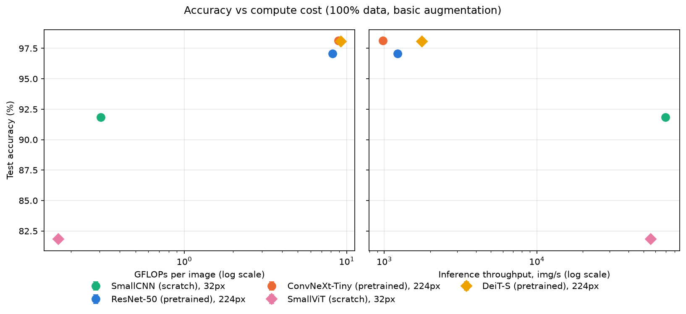
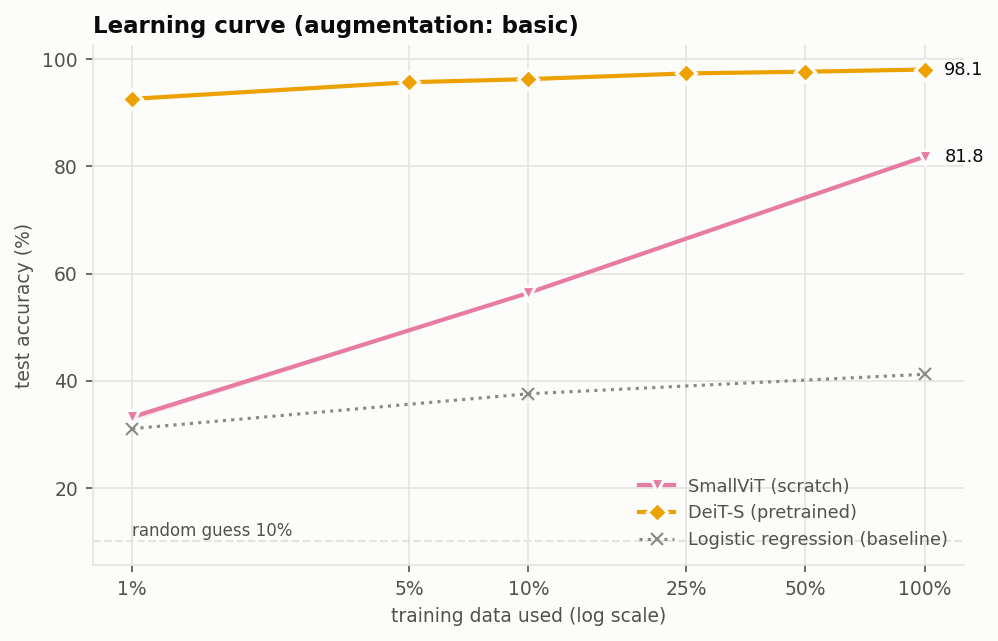
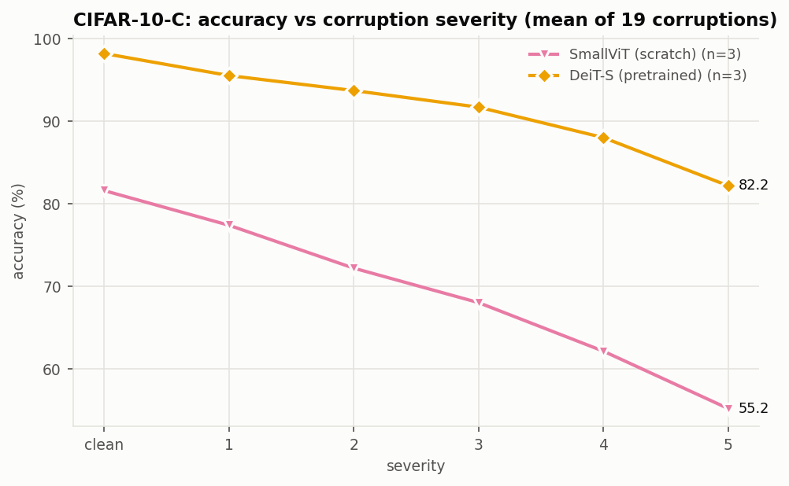
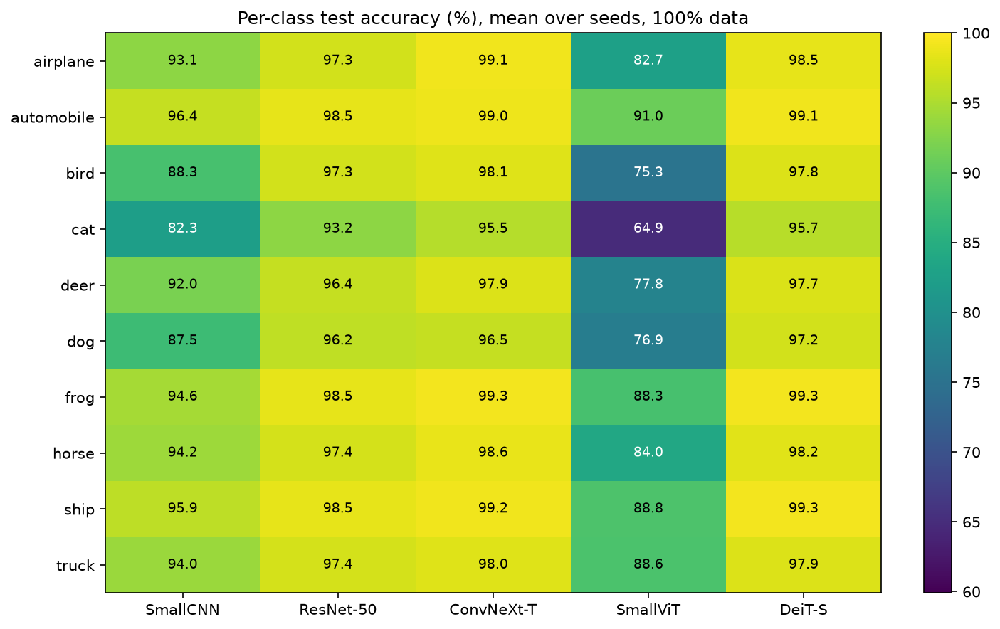

# CNN vs Vision Transformer for Image Classification

Machine Learning and Applications, Topic 7. Compares the inductive biases of CNNs (ResNet,
ConvNeXt) and Vision Transformers with respect to dataset size, data augmentation and compute cost.

**Team:** [names, student IDs, team leader]

**CNN part:** [K] (branch `cnn`). **ViT part:** [Y] (branch `vit`). Both parts use the same data
pipeline, training loop, splits, seeds and experiment grid.

Status: both parts are complete. CNN: 63 training runs. ViT: 45 main runs with tuned learning rates.
Every setting uses 3 seeds; both parts include Grad-CAM / attention rollout and CIFAR-10-C.

## What is compared

| Model | Weights | Input | Parameters | Training |
|---|---|---|---|---|
| ResNet-50 (`resnet50.a1_in1k`) | ImageNet-1k | 224 × 224 | 23.5M | fine-tune 8 epochs |
| ConvNeXt-Tiny (`convnext_tiny.fb_in1k`) | ImageNet-1k | 224 × 224 | 27.8M | fine-tune 8 epochs |
| SmallCNN (own design) | random | 32 × 32 | 1.15M | from scratch, 60 epochs |
| DeiT-S/16 (`deit_small_patch16_224.fb_in1k`) | ImageNet-1k | 224 × 224 | 21.7M | fine-tune 8 epochs |
| SmallViT (own design, patch 4) | random | 32 × 32 | 1.21M | from scratch, 60 epochs |
| Logistic regression on pixels | - | 32 × 32 | 0.03M | baseline |

- **Dataset:** CIFAR-10. Fixed stratified split of 45,000 train / 5,000 validation; the 10,000 test
  images are used once per run, with the checkpoint of the best validation epoch.
- **Learning curves:** 1%, 10% and 100% of the training set (nested, stratified subsets).
- **Augmentation study** at 10% data: none, basic (random crop + flip), strong (basic + RandAugment).
- **Ablation:** frozen backbone (linear probe) and ResNet-50 without pretraining.
- **Interpretation:** Grad-CAM on 20 fixed test images (`results/gradcam_images.json`).
- **Robustness (extension):** CIFAR-10-C, 19 corruptions × 5 severities on a fixed 2,000-image subset.
- **Seeds:** 0, 1, 2 for every setting; results are mean ± std.

Shared settings: AdamW (weight decay 0.05), learning rate 1e-3 for the head and 1e-4 for the
pretrained backbone, 1 warmup epoch then cosine decay, batch size 32, mixed precision. The ViT runs use learning rates tuned on the validation set (see [ViT part](#vit-part)).

## Installation

Requires Conda and Python 3.11. The commands below install the CUDA 12.8 build of PyTorch.

```bash
conda create -n cnn-vit python=3.11 -y
conda activate cnn-vit
pip install -r requirements.txt
python scripts/check_env.py
```

CIFAR-10 is downloaded automatically into `data/`. For the robustness extension, download
CIFAR-10-C from [Zenodo](https://zenodo.org/records/2535967) and extract it to `data/CIFAR-10-C/`.

## Project structure

```text
configs/   One YAML config per experiment, inheriting from base.yaml
src/       Data pipeline, models, training loop, Grad-CAM
scripts/   Command-line entry points
tests/     Data pipeline tests
results/   Final tables and figures (committed)
data/      Datasets (downloaded, not committed)
outputs/   Per-run configs, histories, metrics and test predictions (committed; checkpoints are not)
```

## Reproducing the results

```bash
# tests
pytest tests

# one training run (any value in the config can be overridden with --set)
python scripts/train.py --config configs/resnet50_finetune.yaml --set seed=0 data.train_fraction=0.1

# baseline
python scripts/baseline_logreg.py

# the full grid: learning curves, augmentation study and ablation (63 runs, skips finished runs)
python scripts/run_experiments.py
python scripts/run_experiments.py --dry-run          # list the runs without training

# robustness, Grad-CAM, tables and figures
python scripts/eval_cifar10c.py --runs frac1.0_augbasic_seed0 frac1.0_augbasic_seed1 frac1.0_augbasic_seed2
python scripts/visualize.py
python scripts/summarize_results.py

# RQ3 accuracy vs cost and per-class accuracy (CNN + ViT)
python scripts/accuracy_vs_cost.py
python scripts/per_class_accuracy.py
```

On Windows, `scripts/run_all.ps1` runs all of the last five commands in order.
Each run writes `outputs/<experiment>/frac<f>_aug<a>_seed<s>/` with `config.yaml`, `history.csv`,
`metrics.json` and the test predictions.

## Results

All numbers are test accuracy (%), mean ± std over 3 seeds.
Hardware: NVIDIA GeForce RTX 3050 Ti Laptop GPU (4 GB), PyTorch 2.11, timm 1.0.31.
Full tables: [`results/summary.md`](results/summary.md) and
[`results/cifar10c_summary.md`](results/cifar10c_summary.md).

### Learning curves (basic augmentation)

| Model | 1% (450 images) | 10% (4,500) | 100% (45,000) |
|---|---|---|---|
| ConvNeXt-Tiny (pretrained) | **92.14 ± 0.61** | **96.69 ± 0.19** | **98.13 ± 0.09** |
| ResNet-50 (pretrained) | 73.62 ± 0.35 | 92.70 ± 0.25 | 97.06 ± 0.14 |
| SmallCNN (scratch) | 49.57 ± 1.35 | 77.99 ± 0.52 | 91.84 ± 0.13 |
| Logistic regression | 31.05 ± 0.47 | 37.54 ± 0.33 | 41.21 ± 0.00 |


### Augmentation (10% data)

| Model | None | Basic | Strong |
|---|---|---|---|
| ConvNeXt-Tiny | 96.35 ± 0.12 | 96.69 ± 0.19 | 96.68 ± 0.22 |
| ResNet-50 | 92.12 ± 0.35 | 92.70 ± 0.25 | 92.81 ± 0.21 |
| SmallCNN | 71.77 ± 0.75 | 77.99 ± 0.52 | **79.73 ± 0.47** |

### Ablation

| Variant | Trainable params | 10% data | 100% data |
|---|---|---|---|
| ResNet-50, full fine-tune | 23.5M | 92.70 ± 0.25 | 97.06 ± 0.14 |
| ResNet-50, frozen backbone | 0.02M | 88.04 ± 0.17 | 91.74 ± 0.07 |
| ResNet-50, random init | 23.5M | 56.57 ± 2.14 | 85.44 ± 0.08 |
| ConvNeXt-Tiny, full fine-tune | 27.8M | 96.69 ± 0.19 | 98.13 ± 0.09 |
| ConvNeXt-Tiny, frozen backbone | 0.008M | 91.94 ± 0.12 | 93.94 ± 0.04 |

### Compute cost (100% data)

| Model | Time per run (min) | Train images/s | Peak GPU memory (GB) |
|---|---|---|---|
| ConvNeXt-Tiny, full fine-tune | 42.4 | 152 | 2.26 |
| ResNet-50, full fine-tune | 39.8 | 161 | 1.69 |
| ConvNeXt-Tiny, frozen | 16.2 | 438 | 0.39 |
| ResNet-50, frozen | 15.6 | 463 | 0.43 |
| SmallCNN (60 epochs) | 16.7 | 2,999 | 0.08 |

Accuracy against cost for the five main models (table:
[`results/rq3_accuracy_cost.md`](results/rq3_accuracy_cost.md)). The 32 × 32 models are about 30 times
cheaper per image than the 224 × 224 models; at 224 × 224, DeiT-S/16 matches ConvNeXt-Tiny in accuracy
(98.08 vs 98.13) with 1.8 times its inference throughput.



### Robustness on CIFAR-10-C (models trained on 100% data)

| Model | Clean | Corrupted mean | Relative drop | Noise | Blur | Weather | Digital |
|---|---|---|---|---|---|---|---|
| ConvNeXt-Tiny | 97.95 ± 0.20 | **87.66 ± 0.79** | **10.5%** | 76.3 | 87.8 | 94.8 | 89.5 |
| ResNet-50 | 97.12 ± 0.20 | 76.85 ± 0.70 | 20.9% | 50.5 | 78.1 | 91.5 | 82.1 |
| SmallCNN | 91.83 ± 0.75 | 70.55 ± 0.82 | 23.2% | 53.2 | 67.8 | 80.2 | 77.5 |


### Main findings

- Pretraining matters most when data is scarce: with 450 images ConvNeXt-Tiny is 42.6 points above
  SmallCNN; with all data the gap is 6.3 points.
- ConvNeXt-Tiny is the best CNN at every data size, and ResNet-50 needs more data to catch up.
- Augmentation helps the model trained from scratch (+8.0 points) much more than the pretrained models
  (+0.3 to +0.7).
- Without pretraining, ResNet-50 is worse than the 1.15M-parameter SmallCNN at 10% data.
- ConvNeXt-Tiny and ResNet-50 are almost equal on clean images, but ConvNeXt-Tiny loses half as much
  accuracy under corruptions. Noise is the hardest corruption for every model.

Grad-CAM figures are in [`results/figures/gradcam/`](results/figures/gradcam/).

## ViT part

DeiT-S/16 is the ViT counterpart of ResNet-50 and ConvNeXt-Tiny: same ImageNet-1k-only pretraining, same input size and the same 8-epoch fine-tuning recipe. SmallViT is the counterpart of SmallCNN: same 32 × 32 input, same 60 epochs and almost the same parameter count (1.21M vs 1.15M), so the architecture is the main difference.

| Model | Config | Weights | Parameters | Training |
|---|---|---|---|---|
| DeiT-S/16, full fine-tune | `vit_small_finetune_tuned.yaml` | ImageNet-1k | 21.7M | 8 epochs |
| SmallViT (patch 4, dim 128, depth 6, 4 heads) | `small_vit_scratch_tuned.yaml` | random | 1.21M | 60 epochs |
| ViT-S/16, random init (ablation) | `vit_small_random_tuned.yaml` | random | 21.7M | 8 epochs |
| DeiT-S/16, frozen backbone (ablation) | `vit_small_frozen.yaml` | ImageNet-1k | head only | 8 epochs |

### Learning rates

The learning rate was chosen on the validation set (seed 0, one run per value). The table is in
[`results/vit/tuning_summary.csv`](results/vit/tuning_summary.csv).

| Model | Values tried | Chosen | Val acc (shared default → chosen) |
|---|---|---|---|
| DeiT-S/16 (backbone LR, 100% data) | 1e-5, 3e-5, 1e-4, 3e-4 | 3e-5 | 97.98 → 98.36 |
| SmallViT (100% data) | 1e-4, 3e-4, 1e-3, 3e-3 | 3e-4 | 80.64 → 81.78 |
| ViT-S/16 random init (10% data) | 1e-4, 3e-4, 1e-3 | 3e-4 | 35.14 → 44.94 |

All other settings follow the shared recipe, including no gradient clipping. Runs with the shared default learning rates are kept for reference (`*_noclip`, `vit_small_random`; labelled "lr 1e-4" / "lr 1e-3" in the summary table), and `vit_small_finetune` / `small_vit_scratch` are a gradient-clipping ablation.

### Reproducing

The ViT runs were trained on Google Colab (NVIDIA L4).

```bash
# one run (fraction and augmentation can be overridden like the CNN runs)
python scripts/train.py --config configs/vit_small_finetune_tuned.yaml --set seed=0 data.train_fraction=0.1
python scripts/train.py --config configs/small_vit_scratch_tuned.yaml --set seed=0 data.train_fraction=0.1 data.augmentation=strong

# robustness, attention rollout, tables and figures
python scripts/eval_cifar10c.py --experiments vit_small_finetune_tuned small_vit_scratch_tuned \
    --runs frac1.0_augbasic_seed0 frac1.0_augbasic_seed1 frac1.0_augbasic_seed2 --out results/vit/cifar10c
python scripts/visualize_attention.py --compare-cnn --out results/vit/figures/attention
python scripts/summarize_results.py --results results/vit
```

### Results

Test accuracy (%), mean ± std over 3 seeds. Full table: [`results/vit/summary.md`](results/vit/summary.md).

**Learning curves (basic augmentation)**

| Model | 1% (450 images) | 10% (4,500) | 100% (45,000) |
|---|---|---|---|
| DeiT-S/16 (pretrained) | **92.61 ± 0.33** | 96.29 ± 0.19 | 98.08 ± 0.11 |
| SmallViT (scratch) | 33.21 ± 0.62 | 56.40 ± 0.11 | 81.84 ± 0.13 |



**Augmentation (10% data)**

| Model | None | Basic | Strong |
|---|---|---|---|
| DeiT-S/16 | 96.14 ± 0.13 | 96.29 ± 0.19 | 96.38 ± 0.26 |
| SmallViT | 47.82 ± 0.21 | 56.40 ± 0.11 | **58.68 ± 0.67** |

**Ablation**

| Variant | 10% data | 100% data |
|---|---|---|
| DeiT-S/16, full fine-tune | 96.29 ± 0.19 | 98.08 ± 0.11 |
| DeiT-S/16, frozen backbone | 92.60 ± 0.24 | 93.87 ± 0.06 |
| ViT-S/16, random init | 44.97 ± 0.46 | 65.38 ± 0.54 |

**Compute cost** (all models measured on the same NVIDIA L4, from
[`results/compute_cost.md`](results/compute_cost.md))

| Model | Params (M) | GFLOPs | Inference (img/s) | Train (img/s) | Peak train GPU (GB) |
|---|---|---|---|---|---|
| DeiT-S/16 | 21.67 | 9.20 | 1,768 | 636 | 1.37 |
| ConvNeXt-Tiny | 27.83 | 8.91 | 980 | 371 | 2.26 |
| ResNet-50 | 23.53 | 8.17 | 1,222 | 428 | 1.68 |
| SmallViT | 1.21 | 0.17 | 55,771 | 1,912 | 0.10 |
| SmallCNN | 1.15 | 0.31 | 69,809 | 5,641 | 0.11 |

**Robustness on CIFAR-10-C** (100% data, same 2,000-image subset as the CNN part)

| Model | Clean | Corrupted mean | Relative drop | Noise | Blur | Weather | Digital |
|---|---|---|---|---|---|---|---|
| DeiT-S/16 | 98.23 ± 0.13 | **90.25 ± 0.49** | **8.1%** | 83.1 | 89.1 | 95.4 | 91.9 |
| SmallViT | 81.62 ± 0.36 | 67.00 ± 0.62 | 17.9% | 60.2 | 67.5 | 70.6 | 68.4 |




**Per-class accuracy** (100% data, mean over 3 seeds; 1,000 test images per class, so one image is
0.1 points). Full table with std and the five most confused pairs per model:
[`results/per_class_accuracy.md`](results/per_class_accuracy.md).

| Class | SmallCNN | ResNet-50 | ConvNeXt-T | SmallViT | DeiT-S |
|---|---|---|---|---|---|
| airplane | 93.1 | 97.3 | 99.1 | 82.7 | 98.5 |
| automobile | 96.4 | 98.5 | 99.0 | 91.0 | 99.1 |
| bird | 88.3 | 97.3 | 98.1 | 75.3 | 97.8 |
| **cat** | **82.3** | **93.2** | **95.5** | **64.9** | **95.7** |
| deer | 92.0 | 96.4 | 97.9 | 77.8 | 97.7 |
| dog | 87.5 | 96.2 | 96.5 | 76.9 | 97.2 |
| frog | 94.6 | 98.5 | 99.3 | 88.3 | 99.3 |
| horse | 94.2 | 97.4 | 98.6 | 84.0 | 98.2 |
| ship | 95.9 | 98.5 | 99.2 | 88.8 | 99.3 |
| truck | 94.0 | 97.4 | 98.0 | 88.6 | 97.9 |

The most confused pair is cat ↔ dog for every model. Errors per seed in both directions: SmallViT 283.7, SmallCNN 146.3, ResNet-50 71.3, ConvNeXt-Tiny 61.3, DeiT-S/16 49.3.
The second pair is automobile ↔ truck for every model except SmallViT, where bird ↔ deer and automobile ↔ truck tie (105.7 each).



### Main findings (ViT vs CNN)

- With pretraining, DeiT-S/16 is close to ConvNeXt-Tiny at every data size (92.61 vs 92.14 at 1%, 98.08 vs 98.13 at 100%) and far above ResNet-50 with 450 images (92.61 vs 73.62).
- Without pretraining the ViT falls behind. SmallViT is 10 to 22 points below SmallCNN at every data size, and random-init ViT-S/16 reaches 65.38% at 100% data, against 85.44% for random-init ResNet-50.
- Augmentation matters more for the ViT trained from scratch: +10.9 points from none to strong for SmallViT (SmallCNN: +8.0), against +0.2 for DeiT-S.
- DeiT-S/16 loses the least accuracy under corruptions (8.1% relative drop, against 10.5% for ConvNeXt-Tiny and 20.9% for ResNet-50), and its largest margin is on noise.
- DeiT-S/16 has the highest inference throughput of the three 224 × 224 models on the L4 (1,768 img/s against 1,222 for ResNet-50 and 980 for ConvNeXt-Tiny), at almost the same GFLOPs.
- All five models find the same classes hardest: cat is the weakest class and cat ↔ dog the most confused pair. SmallViT is below SmallCNN on all ten classes, most on cat (−17.4) and deer (−14.2).
- Limitation: the CNN numbers above use the shared default learning rates, while the ViT numbers use tuned learning rates.

Attention rollout figures, including a side-by-side comparison with Grad-CAM on the same images, are in
[`results/vit/figures/attention/`](results/vit/figures/attention/).

## Credits

| Source | Used for | Our changes |
|---|---|---|
| [timm](https://github.com/huggingface/pytorch-image-models) | ResNet-50 and ConvNeXt-Tiny architectures and ImageNet weights | New 10-class head, two learning-rate groups, frozen-backbone option |
| [torchvision](https://github.com/pytorch/vision) | CIFAR-10 download, image transforms, RandAugment | Own split, subsampling and transform pipeline |
| [scikit-learn](https://scikit-learn.org) | Logistic regression baseline, stratified split | - |
| [CIFAR-10-C](https://zenodo.org/records/2535967) | Corrupted test images | Own loader and fixed 2,000-image subset |
| [timm](https://github.com/huggingface/pytorch-image-models) | DeiT-S/16 architecture and ImageNet-1k weights | New 10-class head, two learning-rate groups, frozen-backbone option |
| Abnar and Zuidema (2020) | Attention rollout method | Own implementation for timm ViTs and SmallViT |

Written by the team: the data pipeline, SmallCNN, SmallViT, the training loop, the experiment runner, the
Grad-CAM and attention rollout implementations (`src/interpret.py`), the CIFAR-10-C evaluation and all tables and plots.

## References

1. He et al., [Deep Residual Learning for Image Recognition](https://arxiv.org/abs/1512.03385), 2015.
2. Dosovitskiy et al., [An Image is Worth 16x16 Words](https://arxiv.org/abs/2010.11929), 2020.
3. Liu et al., [A ConvNet for the 2020s](https://arxiv.org/abs/2201.03545), 2022.
4. Wightman et al., [ResNet strikes back](https://arxiv.org/abs/2110.00476), 2021.
5. Selvaraju et al., [Grad-CAM: Visual Explanations from Deep Networks](https://arxiv.org/abs/1610.02391), 2017.
6. Hendrycks and Dietterich, [Benchmarking Neural Network Robustness to Common Corruptions and Perturbations](https://arxiv.org/abs/1903.12261), 2019.
7. Cubuk et al., [RandAugment](https://arxiv.org/abs/1909.13719), 2020.
8. Touvron et al., [Training data-efficient image transformers & distillation through attention](https://arxiv.org/abs/2012.12877), 2021.
9. Abnar and Zuidema, [Quantifying Attention Flow in Transformers](https://arxiv.org/abs/2005.00928), 2020.